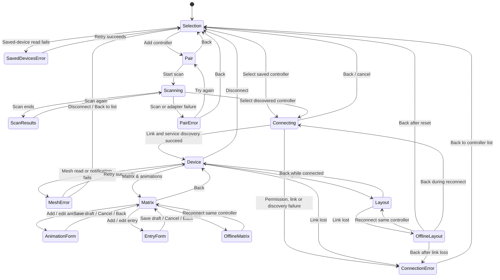

# UI state graph

`BleController` owns Bluetooth readiness. `appRouterProvider` observes it and owns
connection-related redirects; display widgets never schedule navigation timers.

## Invariants

- `BleConnected` always contains the discovered Lumadrive service. Transport
  connection alone stays `BleConnecting`. Discovery failures are visible errors.
- Each scan/connection attempt has a generation. Cancel, reset, Bluetooth loss,
  and replacement attempts invalidate old callbacks and futures. Cleanup cannot
  disconnect a newer connection to the same controller.
- Connection failures preserve saved devices. Explicit Delete removes them.
- `/connect` redirects away from idle/scanning states; it cannot be a blank screen.
  Back from pairing/connection cancels pending work. Ready connections go to
  `/device` through the router. Disconnect returns to selection.
- `/device/layout?controller=<BLE identity>` is a child of `/device`. Its owner
  identifies the local draft and bounds every repository operation. Disconnect
  keeps the draft open, disables Apply/Identify, and exposes Reconnect. Connecting
  a different controller leaves the old editor without sending it that draft.
- Mesh reads and subscriptions belong to one connection generation. Disconnect
  invalidates its matrix client; old reads/notifications cannot restore mesh UI.
- `/device/matrix?controller=<BLE identity>` follows the same ownership rules as
  the layout screen. Forms belong to that screen; Back closes a form first and
  Apply waits until editing finishes. Completed draft edits persist on the phone.
  Layout-only revisions can rebase a matrix draft safely; competing matrix edits
  require an explicit reload.
- Cached output geometry remains available offline, with online indicators cleared.
- Saved-device loading errors expose Retry instead of appearing as an empty list.
  Mesh read/notification failures expose Retry while Bluetooth is still connected;
  connection loss instead offers a return to controller selection.

## Verification

Run `flutter test` and `dart analyze`. Connection tests use controlled permission,
link, discovery, adapter, scan, and notification streams. Router tests cover guards
for every BLE state, ready navigation, cancellation, nested Back behavior, offline
layout retention, and controller changes. Physical Bluetooth behavior still needs
verification on a BLE-capable device.
